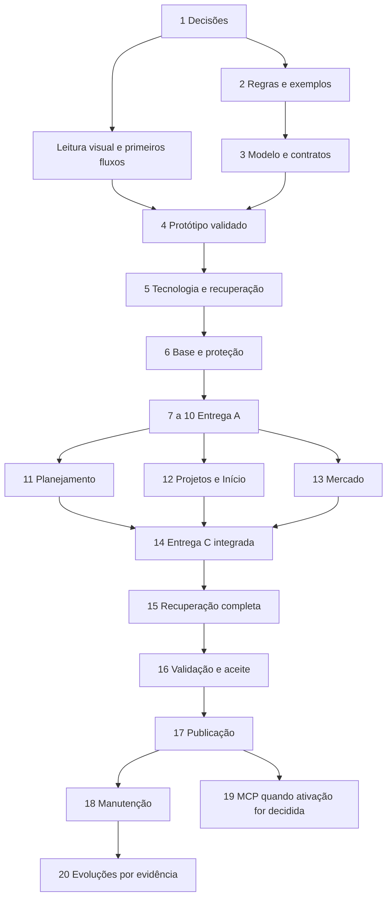

# Workflow de desenvolvimento — aplicativo pessoal / Casa Serena

**Versão do plano:** 1.0, concluída em 29/09/2026; leitura e consultas iniciadas em 28/09/2026. **Situação:** proposta executável para aprovação; nenhuma implementação do aplicativo iniciada. **Fonte principal:** proposta consolidada v1.2, revisada em 28/09/2026. Aprovar este workflow não transforma automaticamente as hipóteses da proposta em decisões de produto.

## 1. Recomendação executiva

Adotar a estratégia **C: um agente principal responsável pelo contexto, decisões, backlog e integração, com especialistas em tarefas delimitadas**. Construir incrementos completos A, B e C da proposta: primeiro o ciclo intenção → aquisição → pagamento → execução; depois planejamento e Mercado; por fim completar a experiência espacial, busca e validação da V1. A identidade Casa Serena e a proteção dos dados começam no primeiro incremento.

A próxima atividade é fechar as decisões que alteram o núcleo, especificar exemplos financeiros, modelar dados/contratos e validar um protótipo navegável. Framework, banco, hospedagem, suporte offline e preços ainda não estão escolhidos. Não há base para prazo, orçamento monetário ou estimativa numérica de esforço.

Preparar todas as operações internas para a futura Berenice desde A. Implementar e ativar o servidor MCP em D, depois de o núcleo estar estável e de se definir o cliente real, autenticação e implantação. D não bloqueia a entrega da V1. O acesso completo já definido não será reduzido a uma integração apenas de consulta.

## 2. Inventário e leitura real dos materiais

| Material | Versão e evidência de leitura | Limitação |
|---|---|---|
| `C:\opscon\proposta_consolidada_app_pessoal_v1 (1).md` | Conteúdo integral, 416 linhas; título interno **v1.2**, data original 24/09 e revisões em 28/09/2026. Lidas §§1–13, RF-01–RF-20 e CA-01–CA-22. | O nome do arquivo menciona v1, mas a versão de conteúdo usada é v1.2. O próprio cabeçalho declara direção recomendada, não escopo integral aprovado. |
| `C:\opscon\descobrir-produto-prd.md` | Texto integral com frontmatter `name: descobrir-produto-prd`, instruções de descoberta, PRD, backlog e revisão; arquivo local de 5.133 bytes. | É o corpo de skill fornecido em `.md`, não uma página com link. Não tem versão interna. Não foi comprovada uma instalação canônica separada chamada `SKILL.md`. |
| `C:\opscon\projetar-agentes-integracoes.md` | Texto integral com frontmatter correspondente, sete seções sobre execução, autorização, estado, dados e protocolos; 8.162 bytes. | Mesma distinção: conteúdo fornecido lido integralmente; instalação separada não comprovada; sem versão interna. |
| `C:\opscon\Guia_visual_Casa_Serena_referencias_aprovadas.pdf` | PDF aberto, texto extraído, 12 páginas renderizadas; capa de 28/09/2026 vinculada à v1.2. As onze imagens incorporadas foram extraídas sem redesenho e abertas individualmente. | A extração textual apresentou falhas de codificação em acentos; a inspeção visual da capa e das imagens foi usada para conferir o conteúdo. |
| D1–D5 | Imagens incorporadas às páginas 2–6, abertas em resolução original de 1536 × 1024. | Não foram acessados arquivos independentes na Biblioteca pelos IDs `libfile_*`; o conteúdo visual está efetivamente disponível no PDF. |
| M1–M6 | Imagens incorporadas às páginas 7–12, abertas em resolução original de 887 × 1774. | Mesma limitação sobre a Biblioteca. As resoluções são das referências, não dimensões CSS obrigatórias do app. |
| Pedido anexado | Texto integral de `C:\Users\hugov\.codex\attachments\f0bd768f-e3ca-4130-88a8-e3c9e577b88b\Texto colado.txt`. | A pasta desse anexo contém apenas esse texto. |
| Projeto local | Inventário de `C:\opscon`: os quatro materiais acima antes deste trabalho. | Nenhum repositório Git, código, manifesto de dependências, testes ou `AGENTS.md` foi fornecido nessa pasta. Não é possível avaliar implementação existente. |
| Documentos históricos | “Markdown.md colado” e `proposta_conceitual_v1.md` são citados na proposta. | Arquivos não encontrados nos materiais fornecidos. A história anterior não foi auditada; o plano se apoia na consolidação atual, como solicitado. |

Foram também lidas as skills auxiliares de PDF e OpenAI Docs para inspeção visual e verificação de capacidades. Não substituem as duas skills do projeto.

**Autoridade:** instruções atuais do usuário; proposta v1.2 para comportamento, estados, nomenclatura e cálculo; imagens aprovadas para aparência, respeitadas as correções explícitas da v1.2 (§8.1); documentos anteriores apenas quando compatíveis. Decisões futuras entram em registro versionado, com motivo e critérios afetados.

**Verificação externa em 28/09/2026, horário de São Paulo:** a [documentação oficial de subagentes](https://learn.chatgpt.com/docs/agent-configuration/subagents) descreve orquestração pelo agente e alerta para maior consumo de tokens e conflitos em escritas paralelas. Nesta sessão, a capacidade foi verificada diretamente: foram criados especialistas de revisão e backlog. Há quatro posições simultâneas informadas pelo ambiente, contando o agente principal; não é uma promessa para qualquer outra sessão. O [índice oficial MCP](https://modelcontextprotocol.io/specification/) apontou para a [especificação 2026-07-28](https://modelcontextprotocol.io/specification/2026-07-28); também foram consultadas as [boas práticas de segurança](https://modelcontextprotocol.io/docs/2026-07-28/tutorials/security/security_best_practices). A versão e a compatibilidade do cliente deverão ser verificadas novamente em D. Nenhum preço de fornecedor foi presumido ou contratado.

## 3. Decisões confirmadas, hipóteses, lacunas e bloqueios

### 3.1 Produto e limites

O produto é uma central pessoal para Vytor conectar o que deseja fazer, o que precisa adquirir, compromissos financeiros e execução. O objetivo é manter dados úteis e facilitar decisões, não maximizar telas ou tempo de uso (§1). As seis áreas são **Início, Casa, Compras, Mercado, Finanças e Projetos**. Planejamento é transversal; revisão periódica é um fluxo opcional (§3).

O ciclo essencial tem entradas independentes: capturar só o nome de um desejo; registrar um gasto avulso; começar uma lista de Mercado. Cadastrar apartamento, renda ou planta não pode ser pré-requisito para todo benefício (§7). Pagamento e entrega podem ocorrer em ordens diferentes: um objeto instalado pode continuar parcelado.

**Definições expressas a preservar:** identidade Casa Serena; Mercado próprio; gastos fora de Casa com vínculos opcionais; um registro compartilhado entre contextos; separação entre compra, obrigação e pagamento; representação aproximada com lista completa; autorização futura completa e revogável da Berenice; regras RF e critérios CA como base de aceitação (§§2–10).

**Premissas e escopo proposto, sujeitos ao fechamento:** uso pessoal sem colaboração, um apartamento, BRL, baixo esforço de manutenção e prioridade a custo recorrente zero (§1). O catálogo da V1 e a sequência A/B/C são a base de trabalho de §6, sem tratar o cabeçalho “direção recomendada” como aprovação geral.

**Hipóteses explícitas:** web responsiva; celular para captura e desktop para planejamento; registro manual sustentável; reconhecimento aproximado dos ambientes suficiente. Offline, sincronização, granularidade por produto e recursos disponíveis ainda precisam ser definidos (§§9/11). Nome “Meu espaço” é provisório.

**Fora da V1 (§6):** 3D navegável/editor arquitetônico, importação de plantas, integração bancária/extratos, OCR, pesquisa automática de preços, IA embutida, pagamentos reais, colaboração, múltiplas moedas, investimentos, calendário completo, hábitos, prontuário e arquivo geral de documentos. Histórico de preço por produto, inventário e ofertas são candidatos posteriores (§5); nenhuma dessas evoluções está automaticamente aprovada. MCP operacional é D, separado da V1.

### 3.2 Decisões que precisam de Vytor e momento de resolvê-las

| ID novo | Decisão | Por que muda execução | Momento / responsável |
|---|---|---|---|
| DEC-01 | Aparelhos/navegadores reais, necessidade de gravar sem internet e uso simultâneo em mais de um aparelho. | Muda armazenamento, sincronização, conflitos, autenticação e testes. Responsividade e instalação não garantem offline. | Antes da escolha de dados; Vytor informa necessidade, principal recomenda solução. |
| DEC-02 | Rotina real de cartão/faturas, gastos e tolerância a captura manual; exemplos de Mercado e contextos. | Muda formulários, ciclos de cobrança e esforço de manter dados. Suporte básico continua previsto; não se remove parcelamento por conveniência técnica. | Antes da especificação detalhada/protótipo; Vytor fornece casos, principal transforma em regras. |
| DEC-03 | Disponibilidade para testar e manter, responsável pela implementação, aceitação de serviço externo e compromisso de custo. | Impede estimar prazo ou escolher serviço sustentável sem fundamento. Zero recorrente é uma meta; limites gratuitos e custo de manutenção contam. | Antes da decisão técnica e de qualquer contratação; Vytor decide compromissos. |
| DEC-04 | Avaliação visual do protótipo, esforço de captura e reconhecimento da casa. | Aprova concretamente a experiência; só paleta não basta. | Etapa 4 e revisão final; Vytor aprova comparações e fluxos reais. |
| DEC-05 | Momento de D, ambiente/cliente em que Berenice opera e primeiras integrações externas, se houver. | Determina transporte, autenticação e implantação MCP. | Antes de D; não impede A/B/C. |

As perguntas serão agrupadas por decisão, sem pedir que Vytor escolha detalhes como algoritmo de centavos, organização de pastas ou biblioteca de ícones. O principal propõe e documenta esses detalhes; só encaminha escolhas que alterem significado do produto, experiência ou custo. Nenhuma resposta adicional é indispensável para entregar este plano.

### 3.3 Regras financeiras e exemplos de referência

Cada número deve indicar **o que mede, a que período pertence, quais registros o compõem e se há dados ausentes**. Usar representação monetária exata em centavos/decimal apropriado; escolher a representação concreta na etapa técnica. Não usar aproximações de ponto flutuante para fechar parcelas/rateios.

| Grupo | Invariante que o núcleo deve garantir | Fonte |
|---|---|---|
| Intenção | Desejo, alternativas, orçamento e estimativa não criam dívida nem caixa. Uma alternativa de referência por necessidade; preço ausente é desconhecido. | RF-01/08/09/16; CA-01/03/09/13 |
| Aquisição | Compra confirmada retira a estimativa atendida do ainda planejado; custo adquirido não recebe o pagamento novamente. | RF-02/03; CA-04/05 |
| Parcelas/rateio | Soma das parcelas = total contratado; distribuição entre itens/contextos fecha o total com frete/descontos. | RF-04/13; CA-04/10 |
| Liquidação | Pagamento é movimento real informado e alocação contra obrigação; fatura agrega obrigações existentes. Entrega não muda valores pagos. | RF-05/06; §4.2; CA-05/06 |
| Transferência | Contas mudam, renda/despesa consolidadas não. Saldo inicial e receita prevista têm natureza distinta. | RF-07/08; CA-07 |
| Reservas | Reserva destina dinheiro existente sem alterar caixa; cobertura da obrigação evita dedução dupla; pagamento consome cobertura. | RF-10/11/12; CA-08 |
| Perspectivas | Casa, categoria, contexto e projeto consultam o mesmo registro; rateios e agregações não replicam o valor total. | RF-12/13/14/17; CA-02/10/16 |
| Correções | Histórico preservado; solicitação de devolução não movimenta caixa; reembolso só quando confirmado. | RF-15; CA-11 |
| Mercado | Lista/carrinho não geram dívida; fechamento único usa total real; detalhe por produto não é despesa adicional; reutilização cria nova lista. | RF-18/19/20; CA-17/18/19 |
| Confiabilidade | Compra, obrigações e vínculos são consistentes; reenvio recupera o resultado sem duplicar; backup recompõe dados e relações. | §9; RF-14/19; CA-12/15 |

**Exemplos obrigatórios ou propostos para a especificação:** valores abaixo são cenários de teste, não estimativas de custo do projeto.

1. **Sofá da proposta (§4.4):** estimativa R$ 3.000 → aquisição R$ 2.700 em 3 × R$ 900 → primeiro pagamento: adquirido R$ 2.700, pago R$ 900, a pagar R$ 1.800, ainda planejado R$ 0. Receber/instalar não altera esses valores.
2. **Centavos, convenção a registrar:** R$ 100 em três parcelas pode ser R$ 33,34 + R$ 33,33 + R$ 33,33. O fechamento é obrigatório; a parcela que recebe o centavo ainda é escolha técnica documentada.
3. **Liquidação parcial:** obrigação R$ 900, pagamento R$ 250 → R$ 650 em aberto. Contar R$ 250 + R$ 650 uma vez no conjunto de obrigações; nunca R$ 900 + R$ 250. A base mensal precisa ser definida separadamente.
4. **Fatura:** obrigações de R$ 900 e R$ 150 → pagamento único de R$ 1.050, com duas alocações. Não criar uma nova aquisição de R$ 1.050.
5. **Transferência:** A = R$ 1.000 e B = R$ 500; transferir R$ 200 → A = R$ 800 e B = R$ 700; consolidado R$ 1.500 e renda/despesa inalteradas.
6. **Rateio proposto:** itens de R$ 600 e R$ 400, frete R$ 50 e desconto R$ 20 → total R$ 1.030. Proporcionalidade produziria R$ 618/R$ 412. Fechar o total é regra; adotar proporcionalidade ainda é proposta.
7. **Reserva, cenário simplificado:** saldo R$ 5.000; reserva R$ 1.000; compra R$ 800 totalmente coberta. Antes de pagar, destinação/compromissos sem sobreposição deixam R$ 4.000. Após pagar, saldo R$ 4.200 e reserva remanescente R$ 200 deixam os mesmos R$ 4.000. Liberar o excedente deixa R$ 4.200. A fórmula candidata `saldo − reservas ativas − obrigações em aberto + cobertura vinculada` só vale com conjunto de contas e horizonte coerentes; não autoriza afirmar capacidade de compra sem dados suficientes.
8. **Devolução:** compra R$ 300 paga; pedir devolução de R$ 100 não aumenta saldo. Reconhecer ajuste de custo e confirmar reembolso são eventos diferentes. Depois do reembolso confirmado, caixa aumenta R$ 100; pagamentos históricos não são apagados. A identidade simples `adquirido = pago + aberto` deixa de ser suficiente quando existem créditos/reembolsos: especificar visão bruta, líquida e ajustes.
9. **Mercado:** arroz sem preço e leite estimado em R$ 6 → subtotal conhecido R$ 6, parcial. Carrinho não afeta finanças. Fechar por R$ 48,90 → uma aquisição real de R$ 48,90, com pagamento/parcelas conforme informado; não somar R$ 6 nem inventar custo do arroz. A nova lista não herda a transação anterior.

### 3.4 Conflitos e lacunas com consequência concreta

| Referência | Constatação | Tratamento proposto / limite |
|---|---|---|
| §4.3 após RF-20 versus §§4.1/4.2 | Orçamento fala em posição “pendente ou paga”, mas liquidação parcial é permitida. | Especificar uma obrigação com componentes pago/aberto sem duplicação. CA-05 não cobre sozinho pagamento parcial de uma mesma obrigação; adicionar cenário complementar. |
| RF-03/16, D4/M4, §12 | Períodos de aquisição, vencimento e pagamento não têm política completa. | Definir base de cada indicador, adiantamento, atraso, retroatividade e saldo inicial com data de corte antes de implementar total mensal. |
| §6 Recorrências e RF-09 | Compromisso previsto pode ser confundido com dívida assumida. | Definir evento de confirmação e estados de previsão/obrigação; nunca gerar pagamento automático. |
| RF-06; §11 cartões | Ciclo de fatura, mudança de vencimento, liquidação parcial e estorno no cartão não estão completos. | Fechar casos básicos reais; rotativo/renegociação continuam excluídos. Não simular juros ou quitação que não ocorreram. |
| RF-10/11 | Faltam escopo da reserva, cobertura parcial, insuficiência, liberação e várias parcelas. | Especificar limites e alocações; testar dinheiro destinado a dois planos concorrentes. |
| RF-02/13/15, §6 Compras | Quantidade parcialmente adquirida; edição após pagamento; devolução reconhecida; frete/desconto não têm todas as transições. | Decidir estimativa restante, ajustes reversíveis e distribuição; preservar pagamentos e trilha de correção. |
| RF-17/19/20 | Cardinalidade de vínculos, correção de lista fechada e destino de produtos pendentes não estão fechados. | Definir rateios/consultas sobrepostas e política de nova lista, sem alterar implicitamente aquisição histórica. |
| D3, PDF p.4; D5, p.6; CA-22 | D3 tem planta decorativa na lateral; D5 também mostra planta fora de Casa. §8 admite ilustração contextual de casa em projeto, enquanto CA-22 restringe planta a Casa. | Recomendar aplicar CA-22: manter composição e usar ilustração contextual sem planta fora de Casa. Registrar exceção visual deliberada; eventual preservação de planta em projeto exigiria revisão explícita do critério, não cópia silenciosa da captura. |
| M3, PDF p.9; §8.1 | “Compras do mês” aparece como desejo na referência antiga. | Retirar supermercado recorrente de Compras e colocá-lo em Mercado. Correção já determinada pela proposta. |
| M2 p.8 e M6 p.12; §§5/8 | M2 não mostra seletor Mapa/Lista; M6 o acrescenta claramente. | M6 e texto atual definem o seletor obrigatório e a preferência persistida. |
| M1–M6; §§8.1/8.3 | Referências não resolvem o novo acesso a Mercado no cabeçalho. | Projetar acionador de menu visível e atalho no Início; manter cinco abas inferiores. Validar espaço, busca e identidade em aparelho real. |
| D3; §13 | Abas/listagem da captura têm inconsistências demonstrativas; ícones/logos variam entre telas. | Normalizar componentes e estados coerentes; não copiar inconsistências como regra funcional. |
| §8 Mercado | Não existe tela aprovada de Mercado. | Produzir e submeter a primeira composição derivada de D3/M3; não alegar correspondência a imagem inexistente. |
| §9; CA-15 | Política de backup/restauração, anexos, conflitos e recuperação de acesso ainda precisa de desenho. | Definir antes da persistência; ensaiar em ambiente limpo desde A, expandir em C. CSV não é backup completo. |

Os bloqueios são locais à decisão: offline bloqueia fechar armazenamento; regras de fatura bloqueiam sua implementação; aprovação visual bloqueia concluir design; falta de cliente MCP bloqueia D. Nenhum deles impede elaborar este plano, exemplos ou um primeiro fluxo de protótipo.

## 4. Workflow completo em ordem de execução

Os caminhos de arquivos desta seção são **destinos propostos para os futuros entregáveis**. Neste trabalho são produzidos apenas este plano, `C:\opscon\features.json` e o inventário de leitura. Não se afirma que os documentos, testes ou software abaixo já existem. Cada etapa termina com evidência; `done` só será usado no backlog depois dessa verificação.

### Etapa 1 — Fechar a base de produto e as decisões determinantes (F001)

- **Objetivo e momento:** converter a proposta em uma base de trabalho aceita antes de decisões caras de reverter, preservando as hipóteses restantes.
- **Pré-requisitos:** materiais inventariados; participação de Vytor em DEC-01–03.
- **Tarefas, em ordem:** registrar autoridade/versões → confirmar resultado da V1 e exclusões → colher dispositivos/offline e casos reais de cartão/Mercado → decidir o que precisa de resposta agora e o que pode esperar → registrar dono e prazo lógico de cada pendência, sem inventar datas.
- **Entregáveis/local:** `C:\opscon\docs\produto\decisoes.md` e `C:\opscon\docs\produto\prd.md`, com status decidido/hipótese/pendente, fonte, motivo e impacto; atualizar F001.
- **Responsável:** principal consolida; Vytor decide necessidades e compromissos pessoais.
- **Conclusão/verificação:** nenhuma hipótese aparece como aprovada; DEC-01 permite escolher dados ou explicita bloqueio; escopo A/B/C e exclusões compreendidos. Revisão pelo principal e confirmação somente das escolhas de produto.
- **CA:** prepara CA-01–CA-22, especialmente CA-16–CA-22; não satisfaz os testes do produto.
- **Risco de pular:** desenvolver para o aparelho errado, descobrir offline tarde ou reduzir escopo sem consentimento.

### Etapa 2 — Especificar comportamento e demonstrar cálculos (F002)

- **Objetivo e momento:** eliminar ambiguidade financeira antes de modelo, telas definitivas e implementação.
- **Pré-requisitos:** base de produto; exemplos de rotina relevantes. Questões de orçamento podem ser trabalhadas junto ao desenho inicial, mas precisam fechar antes de B.
- **Tarefas:** descrever jornadas e campos mínimos → separar máquinas de estado de intenção/entrega/pagamento → definir datas e base de cada total → resolver lacunas da seção 3.4 → detalhar RF-01–RF-20 com entrada/saída/erro → escrever exemplos de parcelas, reservas, faturas, rateios, correções e Mercado → revisar contra todos os CA aplicáveis.
- **Entregáveis/local:** `C:\opscon\docs\produto\regras-funcionais.md`, `C:\opscon\docs\produto\exemplos-financeiros.md` e cenários de aceitação ligados aos IDs originais. Cenários complementares recebem IDs novos, sem renumerar CA/RF.
- **Responsável:** principal com revisão financeira independente; Vytor apenas onde a interpretação muda sua experiência.
- **Conclusão/verificação:** cada RF tem comportamento e exemplo verificável; os exemplos fecham em centavos; pendências do ciclo A resolvidas; nenhuma previsão/carrinho/pagamento é confundida. Revisor reproduz os cálculos a partir das entradas.
- **CA:** prepara CA-01–CA-13 e CA-16–CA-19; define números apresentados em CA-20–CA-22.
- **Risco:** telas plausíveis com totais incompatíveis entre áreas, retrabalho em dados e perda de confiança.

### Etapa 3 — Modelar dados, comandos e recuperação (F003)

- **Objetivo e momento:** estabelecer a fonte única e os limites das operações antes de escolher armazenamento concreto.
- **Pré-requisitos:** regras essenciais da etapa 2; decisão offline/sincronização para fechar o modelo de persistência.
- **Tarefas:** mapear entidades/cardinalidades → definir campos obrigatórios, opcionais e valores desconhecidos → mapear comandos e consultas → delimitar gravações atômicas → desenhar identidade, autorização, repetição e concorrência → definir histórico/reversões → especificar exportação e restauração → construir matriz UI/serviço/futuro MCP.
- **Entregáveis/local:** `C:\opscon\docs\arquitetura\modelo-dados.md`, `C:\opscon\docs\arquitetura\contratos.md`, `C:\opscon\docs\arquitetura\matriz-operacoes-mcp.md` e `C:\opscon\docs\operacao\recuperacao.md`.
- **Responsável:** especialista de arquitetura/dados propõe; principal revisa com financeiro.
- **Conclusão/verificação:** toda ação de jornada tem contrato; operações financeiras têm fronteira de transação, resultado, erro, idempotência e correção; modelo contempla restauração e anexos; mapa da casa não controla dinheiro. Revisão por cenários, inclusive falha a meio de uma compra.
- **CA:** prepara CA-02/04–CA-12/15–CA-19 e CA-14; preparação MCP transversal.
- **Risco:** acesso direto a tabelas pelos adaptadores, duplicação por módulo, corrupção em reenvio e backup irrecuperável.

**Modelo mínimo a avaliar:** dono/identidade; contas e saldo inicial datado; receitas e transferências; cartões/faturas; desejos/alternativas e atendimento por linhas de compra; compra, obrigações, pagamentos e alocações; ajustes/reembolsos; categoria/contexto/cômodo/projeto e rateios; orçamento/reserva/cobertura; recorrência e suas ocorrências; listas/entradas/produtos frequentes de Mercado; projetos/tarefas; anexos/configurações; histórico e operações idempotentes. São responsabilidades de domínio, não uma imposição de uma tabela para cada nome. Estados financeiros e totais serão derivados dos registros autoritativos; caches, se necessários, não viram segunda contabilidade.

**Contrato mínimo por operação:** propósito; identidade obtida de autenticação/contexto confiável; escopo do dono; entrada validada; pré-condições; operação e versão de contrato; identificador de repetição nas escritas; efeitos indivisíveis; identificadores/resultados consultáveis; erros distinguindo rejeição, conflito e resultado desconhecido após interrupção; autoria/origem; forma de corrigir. A mesma chave com entrada diferente deve produzir conflito explícito. Versionamento de registro ou mecanismo equivalente será avaliado para evitar sobrescrever edição concorrente. Não expor SQL arbitrário nem um CRUD que burle regras financeiras.

### Etapa 4 — Design system e protótipo navegável Casa Serena (F004)

- **Objetivo e momento:** validar a experiência completa antes de fechar tecnologia e construir os fluxos. Extração visual pode ocorrer em paralelo às etapas 2/3; o fechamento depende da semântica dos dados.
- **Pré-requisitos:** PDF e onze imagens efetivamente abertos; dispositivos-alvo; fluxos da etapa 2 e contratos suficientes da etapa 3.
- **Tarefas:** catalogar proporções e componentes das referências → definir tokens e estados → montar estruturas desktop/mobile → reproduzir D1–D5/M1–M6 com adaptações registradas → criar Mercado derivado de D3/M3 → ligar captura, compra, pagamento, entrega, correção, gasto fora da casa e lista/fechamento → testar com Vytor → corrigir → comparar lado a lado.
- **Entregáveis/local:** `C:\opscon\docs\design\sistema-visual.md`, `C:\opscon\docs\design\mapa-telas.md`, `C:\opscon\docs\design\revisao-visual.md`; protótipo e sua localização em `C:\opscon\prototipo\` ou ferramenta escolhida registrada no mapa. Ainda não construir agora.
- **Responsável:** especialista de design; principal garante regra/fluxo; Vytor aprova resultado visual e usabilidade.
- **Conclusão/verificação:** onze comparações identificadas e uma composição Mercado desktop/mobile revisadas; fluxos navegáveis com dados coerentes, estados vazios/erro/incompleto e correção; nenhuma imagem inteira usada como interface. Observar esforço e dificuldades com Vytor; registrar medidas observadas, sem meta temporal inventada.
- **CA:** prepara CA-01/03–CA-06/08–CA-14/16–CA-19; evidência de protótipo para CA-20/21/22. Persistência e recuperação ainda exigem implementação.
- **Risco:** aparência genérica verde, celular reduzido do desktop, formulários trabalhosos ou design aprovado com cálculos errados.

**Regras visuais de execução:** marfim `#F5F2EB`, verde `#245C48`, sálvia `#DFE8D9`, superfícies quentes e Manrope como alvo (§8.2), ajustados por referência e contraste; cartões arredondados, contorno/sombra discretos, espaçamentos e pesos definidos. Desktop tem lateral persistente com seis áreas, busca/Novo/perfil no topo e arranjos de conteúdo próprios. Mobile tem cabeçalho com acionador de menu visível, busca/identidade, cartões verticais, cinco destinos inferiores e acesso a Mercado por menu e atalho; prever teclado aberto e espaço para não encobrir ações. M6 orienta Mapa/Lista. Foco, teclado, rótulos, leitura sem cor e redução de movimento entram na revisão. Definir a régua de acessibilidade aplicável na especificação, sem alegar certificação não testada.

### Etapa 5 — Escolher arquitetura, tecnologia e custo de operação (F005)

- **Objetivo e momento:** escolher a menor solução que cumpra fluxos validados e recuperação. Investigar opções antes é permitido; comprometer a stack antes de DEC-01 não é adequado.
- **Pré-requisitos:** etapas 1–4 suficientes; offline, acesso, sincronização e manutenção definidos.
- **Tarefas:** comparar opções de implantação local/servidor conforme necessidade → avaliar persistência transacional, anexos, autenticação e backup → avaliar tecnologia de interface e representação simples da Casa → consultar documentação/licenças/preços oficiais vigentes → definir limites e migração → registrar decisão e custos → obter aceite apenas de compromissos reais de custo/serviço.
- **Entregáveis/local:** `C:\opscon\docs\arquitetura\decisao-tecnica.md`, `C:\opscon\docs\operacao\custos.md`, estratégia de acesso/offline/backup e backlog refinado.
- **Responsável:** principal e especialista técnico; Vytor aceita custos e responsabilidade de operação.
- **Conclusão/verificação:** justificativa compara alternativas, informa versões/documentos e data de consulta; todos os componentes têm dono, custo/limites e caminho de exportação/saída; restauração tecnicamente viável. Nenhum fornecedor gratuito é tratado como gratuito para sempre.
- **CA:** viabiliza todos, especialmente CA-12/14/15/20/21; prepara implantação MCP sem fixar SDK agora.
- **Risco:** dependência paga inesperada, sincronização incompatível, infraestrutura pesada ou V1 impossível de manter.

**Planilha de custo a preencher:** componente, necessidade, fornecedor/versão, preço oficial e data, franquia, limite de dados/anexos/tráfego/execução, inatividade, backup/exportação, cobrança excedente, moeda/impostos quando aplicáveis, mitigação e aceite. Distinguir custo de operar o app, consumo das ferramentas de desenvolvimento e futura execução da Berenice. Sem volumes/dispositivos/serviços decididos, não calcular uma mensalidade fictícia. Propor monólito modular como candidato de baixa manutenção, sem presumir React, Next.js, Supabase ou qualquer provedor.

**Gate de início da implementação:** jornadas revistas, cálculos demonstrados, modelo/armazenamento/recuperação definidos e protótipo essencial validado, conforme §12. Se um requisito de B ainda estiver aberto, registrá-lo e impedir apenas o incremento dependente, desde que não invalide contratos de A.

### Etapa 6 — Preparar projeto e garantias transversais (F006)

- **Objetivo e momento:** criar a base executável escolhida antes da primeira gravação de dados reais.
- **Pré-requisitos:** gate de implementação; tecnologia e ambientes definidos.
- **Tarefas:** criar repositório/estrutura e instruções de execução → fixar dependências/configurações → separar domínio, aplicação, interface e adaptadores → preparar migrações e dados de teste → implementar acesso e recuperação de acesso → construir transações, idempotência e histórico → criar backup/restauração inicial → configurar verificações relevantes.
- **Entregáveis/local:** futuro código em `C:\opscon\src\` ou convenção registrada da stack; `C:\opscon\README.md`, `C:\opscon\docs\arquitetura\estrutura.md`, testes em `C:\opscon\tests\`, migrações e configuração sem segredos. Um `AGENTS.md` pode registrar regras de colaboração se o projeto adotar esse mecanismo.
- **Responsável:** principal integra; especialista implementa infraestrutura delimitada; revisão de acesso/recuperação independente.
- **Conclusão/verificação:** ambiente limpo inicia seguindo README; migração aplica; usuário não autenticado/não autorizado não lê nem grava quando houver servidor; operação de exemplo é atômica, auditada e repetível; conjunto de teste pode ser restaurado. Segredos ficam fora de código, logs e backups de domínio.
- **CA:** prepara CA-02/12/15 e todas as operações financeiras; não esperar D para autorização/auditoria.
- **Risco:** adicionar proteção depois de dados reais, migrations irreproduzíveis e confiança em backup nunca restaurado.

### Etapa 7 — Entrega A: captura, vínculos e Casa pela lista (F007)

- **Objetivo e momento:** obter valor útil com o menor cadastro; criar identidades reutilizadas pelos próximos fluxos.
- **Pré-requisitos:** etapa 6; componentes de Casa Serena e contratos de item.
- **Tarefas:** cadastrar cômodo apenas com nome → capturar item só com nome → editar detalhes/quantidade/prioridade → associar alternativas e estimativa de referência → vincular contextos opcionais → disponibilizar listas e detalhe compartilhado → apresentar valores desconhecidos e estados independentes.
- **Entregáveis/local:** incremento A de UI/domínio e testes; evidências em `C:\opscon\docs\validacao\entrega-a.md`; F007 atualizado.
- **Responsável:** implementador delimitado; principal verifica integração; design revisa componentes reais.
- **Conclusão/verificação:** salvar sem preço/casa/projeto; editar pelo detalhe e conferir o mesmo ID em Casa/Compras; três alternativas não viram três necessidades; lista funciona sem mapa. Vínculo completo com Projetos será fechado em B.
- **CA:** CA-01/03/13/14; CA-02 parcial nesta etapa; prepara CA-16/20/21/22.
- **Risco:** registros duplicados por área, cadastro excessivo e dependência da isometria para usar o app.

### Etapa 8 — Entrega A: aquisição, parcelas, rateios e gasto rápido (F008)

- **Objetivo e momento:** transformar intenção em aquisição pelo mecanismo financeiro único.
- **Pré-requisitos:** etapas 6/7; regras de quantidade, centavos e distribuição resolvidas.
- **Tarefas:** implementar compra/linhas/vínculos → gerar obrigações à vista ou parceladas → distribuir frete/desconto/centavos → substituir estimativa atendida → registrar gasto sem desejo prévio/casa/projeto → apresentar revisão do efeito financeiro → integrar pagamento imediato ao serviço de liquidação da etapa 9.
- **Entregáveis/local:** código, migrações se necessárias e cenários em entrega-a; comandos reutilizáveis também por Mercado futuro.
- **Responsável:** especialista do núcleo financeiro; principal mantém um único responsável pelos contratos/migrações compartilhados.
- **Conclusão/verificação:** CA-04 reproduzido; CA-10 fecha por cômodo e consolidado; CA-16 funciona sem Casa; falha entre criação da compra e obrigações deixa tudo concluído ou nada; reenvio não duplica. Compra à vista só é demonstrada como fluxo completo após a etapa 9.
- **CA:** CA-04/10/12/16; prepara CA-05/06/18.
- **Risco:** compra parcialmente salva, estimativa somada duas vezes ou contabilidade paralela por módulo.

### Etapa 9 — Entrega A: contas, pagamentos, faturas e transferências (F009)

- **Objetivo e momento:** completar o ciclo de caixa sobre obrigações já consistentes.
- **Pré-requisitos:** etapa 8; regras de saldo inicial, datas e fatura básica fechadas.
- **Tarefas:** cadastrar conta/saldo inicial datado e receitas → confirmar pagamentos com alocações totais/parciais → agrupar obrigações em faturas → liquidar fatura sem nova aquisição → transferir entre contas → separar entrega/instalação → tornar cada total consultável pelos registros de origem.
- **Entregáveis/local:** fluxos e testes financeiros em entrega-a; exemplos verificados na aplicação.
- **Responsável:** implementador financeiro; revisor independente confronta RF, efeitos e dados persistidos.
- **Conclusão/verificação:** sofá com R$ 900 pagos/R$ 1.800 abertos; recebimento não muda caixa; fatura tem uma saída e alocações corretas; transferência conserva consolidado; parcial mantém saldo aberto; pagamento exige fato informado. Validar fronteiras mensais e reenvio após resposta perdida.
- **CA:** CA-05/06/07/12/16; complementos para pagamentos parciais e datas.
- **Risco:** dívida liquidada incorretamente, pagamento duplicado ou limite de cartão tratado como saldo.

### Etapa 10 — Entrega A: correção, cancelamento e recuperação mínima (F010)

- **Objetivo e momento:** tornar A utilizável com segurança antes de acrescentar planejamento.
- **Pré-requisitos:** etapas 7–9; regras de devolução e edição após pagamento.
- **Tarefas:** permitir edição com efeito explícito → cancelar/devolver parcialmente sem apagar histórico → registrar reembolso confirmado → preservar/vincular registros existentes → exportar e restaurar todos os tipos já suportados → demonstrar ciclo A inteiro.
- **Entregáveis/local:** entrega A integrada, procedimento mínimo de recuperação e resultados em `C:\opscon\docs\validacao\entrega-a.md`.
- **Responsável:** principal integra; especialista revisa correções e restauração; Vytor experimenta o ciclo.
- **Conclusão/verificação:** CA aplicáveis de A passam; cancelar não inventa entrada; backup em ambiente limpo recupera IDs, vínculos, anexos existentes e totais; cenário de erro permite saber se salvou. Nenhuma operação crítica depende de planilha externa para consertar dados.
- **CA:** CA-11/12/15 no escopo A; consolida CA-01/03–CA-07/10/13/16; CA-02 completa quando Projetos existir.
- **Risco:** expansão sobre um núcleo impossível de corrigir ou recuperar.

### Etapa 11 — Entrega B: orçamento, reservas e recorrências (F011)

- **Objetivo e momento:** acrescentar planejamento com base financeira comprovada.
- **Pré-requisitos:** gate A; política de período, cobertura e confirmação de recorrências fechada.
- **Tarefas:** orçamento mensal e por recortes → reservas sem alterar caixa → cobertura vinculada a obrigações → consumo/liberação/cancelamento → recorrências previstas com instâncias identificadas → revisão mensal e simulação sem compra real → avisos de dados faltantes.
- **Entregáveis/local:** incremento B financeiro e evidências em `C:\opscon\docs\validacao\entrega-b.md`.
- **Responsável:** implementador financeiro e revisor de invariantes; principal revisa nomes de indicadores.
- **Conclusão/verificação:** exemplo de reserva preserva disponibilidade sem dupla dedução; parcial/excedente/cancelamento coerentes; obrigação não consome orçamento ao surgir e novamente ao pagar; recorrência não confirma pagamento e reexecução não duplica ocorrência; projeção informa horizonte e ausências.
- **CA:** CA-08/09/12/13; reforça CA-05/11; recorrências exigem cenários suplementares.
- **Risco:** dinheiro comprometido em dois planos, previsão apresentada como caixa ou dívida automática indevida.

### Etapa 12 — Entrega B: Projetos e Início (F012)

- **Objetivo e momento:** relacionar próximos passos aos registros financeiros existentes sem criar gestão complexa.
- **Pré-requisitos:** A e contratos de planejamento; totais de reservas/orçamento dependem da etapa 11.
- **Tarefas:** projeto com resultado/próxima ação/tarefas/prazo opcional → tarefas avulsas → vínculos de compra existentes → progresso por execução → custos separados do progresso → Início com plano, vencimentos e dados faltantes → revisão opcional.
- **Entregáveis/local:** telas/serviços e evidências em entrega-b; composições D1/M1/D5/M5.
- **Responsável:** implementador de projetos/UI; principal integra consultas, design confere conteúdo contextual.
- **Conclusão/verificação:** viagem R$ 8.000 sem contratação não cria dívida; mesmo item em Casa/Compras/Projeto mantém ID e alterações; quitar não conclui tarefa; Início permite assuntos além de casa e atalhos úteis.
- **CA:** CA-02/09/16/22; prepara CA-20/21; tarefas e Início têm aceitação adicional em F012.
- **Risco:** orçamento vira obrigação, projeto duplica compras ou a casa domina todos os contextos.

### Etapa 13 — Entrega B: Mercado com fechamento único (F013)

- **Objetivo e momento:** reaproveitar o núcleo A para uma jornada recorrente de captura e aquisição.
- **Pré-requisitos:** A; design Mercado e política de lista fechada/reutilização revisados. Pode ocorrer em paralelo às etapas 11/12, com contratos estabilizados.
- **Tarefas:** lista ativa/entrada rápida → quantidade/unidade e seção opcionais → frequentes/reutilização → carrinho sem efeito financeiro → subtotal parcial → revisão de total real/data/conta/cartão → fechamento atômico pelo serviço comum → histórico/correção → nova ida preservando anterior.
- **Entregáveis/local:** lista funcional desktop/mobile, vínculo único com compra e testes em entrega-b.
- **Responsável:** implementador de Mercado, com revisão financeira do fechamento e revisão visual da nova área.
- **Conclusão/verificação:** executar CA-17/18/19; repetir fechamento após falha de conexão; preços individuais desconhecidos continuam desconhecidos; produtos não surgem como desejos permanentes nem despesas adicionais.
- **CA:** CA-17/18/19/12/13/16/22; contribui CA-20/21.
- **Risco:** poluir Compras, perder histórico ou cobrar novamente cada produto e o total da compra.

### Etapa 14 — Entrega C: isometria, navegação, busca e experiência completa (F014)

- **Objetivo e momento:** completar a identidade espacial sobre dados já úteis e consolidar a experiência V1.
- **Pré-requisitos:** listas de A; fluxos de B integrados para a revisão global; fidelidade aproximada confirmada.
- **Tarefas:** implementar modelos simples/ajustes permitidos → selecionar cômodos ligados aos IDs → Mapa/Lista e memória de preferência → falha do visual mantém lista → busca por texto em todas as áreas com contexto → Novo contextual → finalizar navegação/menu Mercado → revisar estados, teclado, foco e layout responsivo.
- **Entregáveis/local:** incremento C, capturas e comparações em `C:\opscon\docs\validacao\entrega-c.md` e relatório visual.
- **Responsável:** especialista visual/UI com implementação delimitada; principal verifica fluxos e desempenho nos aparelhos escolhidos.
- **Conclusão/verificação:** sem biblioteca/mapa ainda se cria/edita/paga pela lista; seleção e retorno preservam contexto; busca cobre seis áreas; cinco abas mobile; nenhuma ação coberta pela barra/teclado; onze referências comparadas e adaptações justificadas.
- **CA:** CA-14/20/21/22; revalida CA-01/02/13/17/18.
- **Risco:** mapa bloqueia uso, interface estática, regressões no celular e aparência sem fidelidade apesar de cores semelhantes.

### Etapa 15 — Completar proteção, exportação, backup e restauração (F015)

- **Objetivo e momento:** estender as garantias de A a todo o modelo antes da publicação.
- **Pré-requisitos:** entidades/fluxos A/B/C disponíveis; procedimento inicial de recuperação.
- **Tarefas:** exportar CSV para consulta → pacote estruturado versionado com dados/vínculos/configurações/anexos → validar integridade e compatibilidade → definir substituição/mesclagem e prevenção de duplicidade → restaurar em ambiente limpo → revisar autorização de todas as operações/anexos/backup → testar perda de acesso, retenção e atualização/migração.
- **Entregáveis/local:** rotinas operacionais completas, `C:\opscon\docs\operacao\backup-restauracao.md`, `C:\opscon\docs\operacao\acesso.md` e relatório do ensaio.
- **Responsável:** especialista de dados/segurança; principal executa/verifica restauração independente do exportador.
- **Conclusão/verificação:** registros, relacionamentos, configurações, anexos e totais financeiros equivalentes; pacote inválido/incompatível é rejeitado com explicação e sem perda do estado válido; backup não restaura credenciais revogadas silenciosamente. Recuperação de acesso demonstrada no modo de implantação escolhido.
- **CA:** CA-15 completo, CA-11/12 e controles de §9 não cobertos isoladamente por CA.
- **Risco:** exportação aparente sem restauração real, vazamento de anexos, perda de vínculos ou sobrescrita de dados bons.

### Etapa 16 — Validar V1 integrada e obter aceite visual/funcional (F016)

- **Objetivo e momento:** comprovar o conjunto antes da publicação; testes de cada incremento já terão ocorrido.
- **Pré-requisitos:** A/B/C integradas e etapa 15; ambiente de validação recuperável.
- **Tarefas:** executar CA-01–CA-22 com dados controlados → testar invariantes e falhas relevantes → comparar lado a lado desktop/mobile → testar jornadas com Vytor nos dispositivos-alvo → classificar defeitos → corrigir e repetir apenas verificações afetadas → registrar aceite e limitações.
- **Entregáveis/local:** `C:\opscon\docs\validacao\matriz-ca.md`, evidências funcionais, capturas, relatório de acessibilidade e pendências, com versão/revisão testada.
- **Responsável:** revisor independente recebe especificação, diff, resultados e telas; principal reconcilia; Vytor valida esforço de uso e fidelidade.
- **Conclusão/verificação:** todos os CA com evidência de aprovação; RF-01–RF-20 cobertas por cenários pertinentes; sem defeito aberto que invalide integridade, acesso, recuperação ou aceitação; limitações conhecidas registradas sem chamar requisito não cumprido de concluído.
- **CA:** CA-01–CA-22; MCP operacional ainda não avaliado como pronto.
- **Risco:** publicar uma coleção de telas que funciona só no caminho feliz ou depender de aprovação verbal do implementador.

**Testes com maior retorno:** cálculos e transições de domínio; integração para atomicidade/persistência; reenvio com resposta perdida e chave divergente; duas escritas concorrentes quando aplicável; invariantes de soma em parcelas/rateios; devolução após pagamento; datas de fronteira; restauração limpa; fluxos essenciais de ponta a ponta; revisão visual e acessibilidade manual. Se offline entrar no escopo, acrescentar retomada, conflito e indicação de pendência. Evitar testes que apenas repetem detalhes internos sem verificar comportamento.

### Etapa 17 — Publicar e entregar operação recuperável (F017)

- **Objetivo e momento:** disponibilizar a V1 aprovada com acesso, dados e procedimento de reversão definidos.
- **Pré-requisitos:** gate da etapa 16; destino/custo/acesso aprovados conforme etapa 5; contas/credenciais de implantação disponíveis quando necessárias.
- **Tarefas:** preparar pacote/configuração → separar dados demonstrativos → conferir segredos e acesso → backup antes de migração → aplicar versão/migrações → verificar fluxo básico no destino → conferir anexos e exportação → documentar acesso, suporte e rollback.
- **Entregáveis/local:** aplicativo no destino escolhido, versão de liberação, `C:\opscon\docs\operacao\publicacao.md` e `C:\opscon\docs\operacao\manual-v1.md`.
- **Responsável:** principal e ferramenta de implantação; Vytor apenas para credenciais, contratação ou exposição que dependam dele.
- **Conclusão/verificação:** Vytor acessa nos aparelhos definidos; captura/compra/pagamento/Mercado persistem após recarga; backup pode ser obtido; sem dados demonstrativos misturados; reversão ensaiada/documentada e versão identificável.
- **CA:** verificação básica de CA-01/04/05/12/15/18/20/21; a matriz completa pertence à versão validada.
- **Risco:** teste local não corresponder à produção, dados expostos, migração destrutiva ou indisponibilidade sem recuperação.

### Etapa 18 — Manter, observar uso e priorizar correções (F018)

- **Objetivo e momento:** sustentar confiança e baixo esforço de manutenção após a primeira entrega.
- **Pré-requisitos:** V1 publicada; responsável e procedimento operacional definidos.
- **Tarefas:** registrar problemas reais e dificuldade de captura → acompanhar erros e limites de infraestrutura sem expor dados → executar política de backup e ensaios de recuperação → revisar dependências e migrações → corrigir com regressão dirigida → revisar backlog e decidir próximos incrementos.
- **Entregáveis/local:** `C:\opscon\docs\operacao\manutencao.md`, changelog, histórico de incidentes/restaurações e `features.json` atualizado.
- **Responsável:** principal quando acionado; ferramentas/automação somente se configuradas e autorizadas; Vytor fornece feedback e decisões de evolução.
- **Conclusão/verificação inicial:** manual, responsáveis, gatilhos e rotina definidos; nenhuma promessa de monitoramento automático sem configuração real. A atividade recorrente permanece contínua; F018 cobre estabelecer e executar sua primeira verificação, não “terminar a manutenção”. Frequências, retenção e tolerância à perda de dados serão acordadas, sem números inventados.
- **CA:** preserva CA-01–CA-22, com atenção a CA-11/12/15; revalidar critérios afetados por alterações.
- **Risco:** backup esquecido, limites gratuitos mudando, dependências abandonadas e aumento do esforço de registrar dados.

### Etapa 19 — Entrega D: ativar MCP completo para Berenice (F019)

- **Objetivo e momento:** adicionar operação externa ao núcleo estável, sem atrasar o uso de A/B/C.
- **Pré-requisitos:** operações V1 estáveis, DEC-05, cliente real e implantação definidos; revalidar especificação/SDK/segurança e custos oficiais na data da execução.
- **Tarefas:** inventariar todas as ações disponíveis a Vytor → mapear para serviços existentes → implementar adaptador servidor MCP e autenticação adequada ao transporte → dar identidade própria e revogável à Berenice → expor consulta/busca/criação/edição/vínculo/conclusão/cancelamento/exportação/recuperação/administração aplicáveis → validar entradas/escopo/resultados → testar equivalência e falhas → ativar e documentar revogação.
- **Entregáveis/local:** adaptador, catálogo de ferramentas/recursos, matriz de paridade e `C:\opscon\docs\integracoes\berenice-mcp.md`; testes específicos em `C:\opscon\tests\mcp\` ou convenção da stack.
- **Responsável:** especialista de integrações; revisor de acesso; principal reconcilia contratos; Vytor define cliente/ativação/compromissos.
- **Conclusão/verificação:** cobertura operacional completa em todas as áreas; mesma operação na UI/MCP produz efeitos equivalentes; repetição retorna resultado sem duplicar; histórico identifica Berenice; revogação bloqueia leitura/escrita; dados insuficientes não geram confirmação de pagamento. Permissões persistentes para operações cotidianas respeitam a autorização já dada, sem impor confirmação repetitiva artificial. Limitações do host/cliente devem ser testadas, não prometidas como contornáveis pelo servidor.
- **CA:** reusa CA-01–CA-19 onde aplicáveis ao domínio; acrescenta MCP-01–MCP-06 da seção 6. CA-20–CA-22 continuam responsabilidade da UI.
- **Risco:** integração somente leitura indevidamente chamada de completa, caminho alternativo sem regras, credencial não revogável ou pagamento inventado.

O servidor verifica identidade e escopo em cada operação. A implementação deve seguir as orientações vigentes de autenticação, incluindo validação de tokens para o destinatário correto; não repassar credenciais indevidamente. Segredos não entram em prompts/logs. Documentos/links consultados são dados, não instruções autorizadoras. Não expor ferramenta universal de SQL/HTTP/shell. Conectores externos, se aprovados, têm destinos, credenciais e políticas próprias. O app servir ferramentas por MCP é diferente de consumir serviços externos como cliente MCP; A2A/UCP/RAG não são necessários para cumprir esta entrega.

### Etapa 20 — Avaliar evoluções posteriores por dificuldade observada (F020)

- **Objetivo e momento:** investir somente onde o uso demonstrar benefício, mantendo o foco do produto.
- **Pré-requisitos:** evidência de uso, problema concreto e aprovação do novo escopo; esta etapa não bloqueia V1 nem D.
- **Tarefas:** identificar esforço recorrente → comparar solução simples e integração → validar custo/dados/permissões → criar especificação e critérios próprios → aprovar prioridade → decompor em novos IDs antes de implementar.
- **Entregáveis/local:** `C:\opscon\docs\produto\evolucoes.md` e novas features; preservar F020 como avaliação de candidatos, sem representar tudo como um único pacote implementável.
- **Responsável:** principal recomenda; Vytor prioriza e aceita compromissos.
- **Conclusão/verificação:** cada candidato aprovado tem problema, benefício observável, dependências, custo verificado e aceite próprio; candidatos recusados/adiados continuam identificados. Nenhuma exclusão da V1 entra por acidente.
- **CA:** preservar CA existentes; criar critérios novos apenas para novos requisitos.
- **Risco:** integração antecipada, crescimento de manutenção e arquitetura orientada a funções que ninguém usa.

### Caminho crítico, paralelismo e gates

**Caminho crítico lógico:** fechar decisões de dados/acesso → especificar semântica → estabilizar contratos e validar protótipo → escolher tecnologia/recuperação → completar A → integrar B/C → comprovar restauração/aceitação → publicar. Sem durações fundamentadas não é possível calcular um caminho crítico de calendário ou prometer que uma frente é a mais demorada.

**Em paralelo:** análise financeira e extração visual; pesquisa técnica sem compromisso enquanto o protótipo é refinado; depois de A, Mercado e partes de Projetos/Planejamento com contratos estáveis; testes e documentação junto a cada incremento. Componentes de isometria podem ser explorados após as listas estarem prontas, mas o aceite C exige integração. Protótipo de fatura espera semântica de fatura; fechamento de Mercado espera comando financeiro comum. Um único responsável integra mudanças de contratos e migrações compartilhadas.

**Gates de liberação:** G1 = decisões determinantes registradas; G2 = regras demonstradas; G3 = contratos e recuperação revisados; G4 = protótipo/tecnologia aceitos para iniciar; G-A = ciclo A, correção e recuperação mínima; G-B = planejamento/Projetos/Mercado integrados; G-V1 = A/B/C, todos CA e restauração completa; G-P = publicação verificada; G-D = MCP operacional completo e revogável. Critérios preparados no design/modelo não contam como produto entregue.

## 5. Estratégias de agentes e escolha justificada

| Dimensão | A — Um agente faz tudo em sequência | B — Um agente diferente por fase | C — Principal mantém contexto e delega tarefas delimitadas |
|---|---|---|---|
| Contexto | Boa continuidade, mas contexto longo e premissas equivocadas podem persistir. | Depende de repasse completo em cada transição; aumenta risco de perder hipóteses e exceções. | Principal mantém fonte única; especialista recebe só o necessário, com versão e limites. |
| Contradições | Menos repasses; mesmo autor pode não perceber seu erro. | Produto, dados e design podem reinterpretar “gasto”, reserva ou Casa Serena de formas diferentes. | Principal reconcilia contra proposta, decisões, RF/CA e evidência; contratos compartilhados têm dono. |
| Coordenação | Baixa. | Alta: preparar, transferir e conferir cada fase. | Moderada e justificada pelo risco/independência da tarefa. |
| Paralelismo | Praticamente inexistente entre agentes. | Trocar responsável por fase não elimina dependências; muitas fases continuam sequenciais. | Útil em análise financeira/visual, módulos com contratos estáveis e revisões. |
| Revisão independente | Fraca quando o próprio autor faz toda a revisão. | Possível, mas mudar de agente não garante revisão nem contexto correto. | Revisor recebe especificação, diff, testes e capturas; pode contestar o implementador com evidência. |
| Custo/limites | Menos repasses e geralmente menos trabalho duplicado; não garante menor custo total se houver retrabalho. | Mais releitura e coordenação; ganhos incertos se a divisão for puramente por fase. | Mais consumo quando especialistas atuam; usar somente onde reduz risco ou permite trabalho independente. Não há preço numérico apurado. |
| Intervenção de Vytor | Pode aumentar quando dúvidas se acumulam sem segunda revisão. | Risco de repetir explicações e arbitrar divergências entre agentes. | Concentrada em produto, uso real, aprovação visual, custos e decisões pessoais. |
| Adequação | Aceitável para ajustes pequenos e manutenção localizada. | Pouco adequada como regra fixa para este projeto integrado. | Recomendada para finanças compartilhadas, fidelidade visual e preparação MCP. |

**Recomendação C:** a contabilidade determinística exige continuidade; a leitura visual e revisão de segurança se beneficiam de foco independente. Um “agente por tela” ou “agente por fase inteira” sem contratos estáveis criaria risco de implementar finanças diferentes em Mercado, Compras e Casa. O principal responde pelo produto integrado, mesmo quando delega.

**Capacidade real:** o principal conseguiu criar subagentes e receber análises nesta sessão; o ambiente informou quatro posições simultâneas, incluindo o principal. Vytor não precisa iniciar chats manualmente para essas divisões. Isso não significa agentes ilimitados nem execução automática permanente. Limites de uso e permissões continuam aplicáveis: a elaboração do backlog foi interrompida por limite de uso depois de produzir o arquivo; o principal assumiu sua leitura e verificação. Em outra sessão, a capacidade deverá ser conferida novamente; sem delegação disponível, o plano segue sequencialmente e identifica a ausência de revisão independente. Não é necessário adotar um runtime de múltiplos agentes dentro do aplicativo.

| Trabalho delegado | Pacote de entrada | Saída exigida | Como o principal aceita/reconcilia |
|---|---|---|---|
| Regras financeiras | Proposta v1.2, RF/CA, registro de decisões e exemplos reais. | Tabelas de cálculo, ambiguidades, invariantes, cenários de falha com referências. | Refaz exemplos críticos; conserva a regra documentada; leva a Vytor apenas decisão de produto ainda ausente. |
| Design | Proposta **e PDF**, imagens D/M efetivamente abertas, fluxos/contratos e dispositivos. | Tokens/componentes, protótipo, onze comparações e telas novas de Mercado, lista de adaptações. | Regras atualizadas governam números/estados; imagens governam aparência; exceções como D3/CA-22 são registradas; Vytor aprova resultado visual. |
| Arquitetura e recuperação | Regras demonstradas, dispositivos/offline, fluxos e restrições de custo. | Entidades, contratos, alternativas técnicas, custo datado, plano de restauração, matriz MCP. | Escolhe menor arquitetura suficiente, evita serviços/protocolos sem caso de uso e verifica efeitos sobre todos os módulos. |
| Implementação delimitada | Feature pronta para executar, dependências concluídas, contratos/design, arquivos sob sua responsabilidade e RF/CA. | Diff/código, execução do fluxo, resultados de testes, migrações e limitações. | Integra por comportamento; valida efeitos cruzados. Não aceita apenas “compilou” ou mensagem final do implementador. |
| Revisão independente | Especificação, versão testada, diff, dados/resultados e telas, sem depender de relato do autor. | Defeitos reproduzíveis, gravidade/impacto, critério violado e evidência. | Distingue defeito de preferência; corrige e repete verificação pertinente; documenta divergências resolvidas. |

O principal mantém sequenciais: fechamento de semântica → contrato; migração → revisão → aplicação; núcleo de compra/pagamento → integração de Mercado; restauração comprovada → uso confiável de backup; aceite de custo → contratação; validação → publicação. Em arquivos compartilhados, atribuir um único responsável por vez ou checkout isolado quando apropriado. Especialistas não sobrescrevem decisões aprovadas nem editam os mesmos contratos simultaneamente.

Para cada tarefa, o principal registra pergunta/objetivo, escopo permitido, versão das fontes, arquivos, critério de término e artefato esperado. Achados contraditórios são comparados à autoridade das fontes e reproduzidos com exemplo; quantidade de agentes concordando não substitui evidência. Alteração de regra gera decisão registrada e atualização dos critérios afetados. O histórico de conversa não é a única memória do projeto.

## 6. Backlog inicial e rastreabilidade

O arquivo **`C:\opscon\features.json`** contém 20 unidades iniciais, IDs F001–F020, prioridade, fase, escopo da prioridade, status, valor ao usuário, critérios completos, dependências, CA/RF, referências visuais, fontes e perguntas. São unidades de entrega; antes de implementar uma unidade grande, dividi-la em tarefas menores com IDs novos vinculados ao ID pai, preservando o histórico. Nenhuma está marcada como implementada.

`must-have` significa necessário **dentro do escopo indicado**: F019 é obrigatório para considerar D completo, mas não bloqueia V1. F020 é `nice-to-have`, apenas avaliação de candidatos não aprovados. F018 representa instituir manutenção da V1, embora sua fase seja posterior à publicação. Todos começam `not_started`; material deste planejamento não é prova de que um requisito do app passou.

| ID / etapa | Entrega e prioridade | Dependências para conclusão |
|---|---|---|
| F001 | Preparação: decisões — must-have | Nenhuma |
| F002 | Preparação: especificação e exemplos — must-have | F001 |
| F003 | Preparação: modelo/contratos/recuperação — must-have | F002 |
| F004 | Preparação: design/protótipo — must-have | F002, F003; exploração visual pode começar antes |
| F005 | Preparação: tecnologia/custo — must-have | F003, F004 |
| F006 | A: estrutura/proteção/auditoria — must-have | F005 |
| F007 | A: itens/alternativas/listas — must-have | F006 |
| F008 | A: aquisição/rateios/parcelas/gasto — must-have | F007 |
| F009 | A: contas/pagamentos/faturas/transferências — must-have | F008 |
| F010 | A: correções/recuperação e gate — must-have | F009 |
| F011 | B: orçamento/reservas/recorrências — must-have | F010 |
| F012 | B: Projetos/Início — must-have | F010, F011; tarefas/vínculos independentes podem começar em paralelo |
| F013 | B: Mercado — must-have | F010 |
| F014 | C: isometria/busca/navegação — must-have | F011, F012, F013 |
| F015 | C: recuperação completa — must-have | F011, F012, F013, F014 para fechamento final |
| F016 | C: validação integral — must-have | F014, F015 |
| F017 | Publicação V1 — must-have | F016 |
| F018 | Operação V1: manutenção — must-have | F017 |
| F019 | D: MCP completo — must-have somente em D | F017 + decisão de ativação; não depende de F018 terminar |
| F020 | Posterior: avaliar candidatos — nice-to-have | F017 + evidência de necessidade; não depende de D |

### Matriz de CA preservados

O texto completo e obrigatório continua em §10 da proposta. Esta matriz resume cada resultado, aponta implementação principal e tipo de evidência. F002–F005 preparam; F016 verifica o conjunto; nenhum deles substitui a implementação indicada.

| Critério | Resultado preservado | Implementação principal | Evidência necessária |
|---|---|---|---|
| CA-01 | Item só com nome, sem preço/cômodo/projeto/planta. | F007 | Captura, persistência e reabertura pela UI. |
| CA-02 | Mesmo registro em Casa/Compras/Projeto e alterações refletidas. | F007 + F012 | Conferir ID/vínculos e edição pelas três perspectivas; completo em B. |
| CA-03 | Três alternativas, uma necessidade e estimativa de referência. | F007 | Projeção e dados demonstram ausência de triplicação. |
| CA-04 | R$ 2.700 adquiridos, 3 × R$ 900, retirar estimativa R$ 3.000. | F008 | Cenário financeiro exato em domínio, persistência e UI. |
| CA-05 | R$ 900 pagos/R$ 1.800 abertos; recebimento não muda valor. | F009 | Pagamento seguido de recebimento e conferência de caixa/obrigações. |
| CA-06 | Fatura paga com uma saída, sem nova compra/duplicação. | F009 | Uma movimentação e alocações para obrigações existentes. |
| CA-07 | Transferência R$ 200 não muda renda/despesa consolidada. | F009 | Dois saldos e consolidado antes/depois; falha não salva metade. |
| CA-08 | Reserva e obrigação não descontam duas vezes. | F011 | Cenários de cobertura, pagamento parcial, liberação e cancelamento. |
| CA-09 | Viagem estimada em R$ 8.000 não cria dívida. | F011 + F012 | Projeto/planejamento e ausência de obrigação/movimento. |
| CA-10 | Compra em dois cômodos rateada com total exato. | F008 | Soma de rateios com frete/desconto e recortes. |
| CA-11 | Cancelamento/devolução preservam histórico; caixa só no reembolso. | F010 | Estados intermediários e comparação de custo/obrigações/caixa. |
| CA-12 | Reenvio após falha conclui/recupera sem duplicação. | F006, F008–F010, F013 | Falha antes/depois do commit, perda de resposta, mesma chave e chave com conteúdo divergente. |
| CA-13 | Item sem preço torna total parcial e localizável. | F007/F008/F011/F013 | UI e cálculo mantêm ausência distinta de zero em cada agregado. |
| CA-14 | Casa totalmente utilizável pela lista sem representação. | F007 + F014 | Forçar indisponibilidade do mapa e executar ações essenciais. |
| CA-15 | Backup restaurado em ambiente limpo recupera vínculos/anexos/totais. | F006/F010 inicial; F015 completo | Comparação de registros, relações, configurações, anexos e totais. |
| CA-16 | Gastos de viagem/passeio/relacionamento sem Casa e sem duplicação. | F008 + F009 | Registro mínimo, filtros por categoria/contexto e consolidado. |
| CA-17 | Arroz sem preço/leite estimado/carrinho: parcial, sem efeito financeiro. | F013 | Lista versus saldos/obrigações/pagamentos antes/depois. |
| CA-18 | Fechamento Mercado cria uma transação pelo total real. | F013 sobre F008/F009 | Lista vinculada, efeitos à vista/parcelados e reenvio. |
| CA-19 | Reutilizar lista e alterar leite preserva compra anterior. | F013 | Novos IDs de lista/entradas; histórico e transação anterior inalterados. |
| CA-20 | Fidelidade desktop D1–D5, acrescentando Mercado. | F004 protótipo; F012/F013/F014 implementação | Comparações lado a lado, dimensões e diferenças deliberadas anotadas. |
| CA-21 | Fidelidade M1–M6, cinco abas, menu e atalho Mercado. | F004 protótipo; F013/F014 implementação | Comparações, navegação e toque/rolagem em dispositivos-alvo. |
| CA-22 | Unidade Casa Serena e conteúdos próprios, planta só em Casa. | F004/F012/F013/F014 | Revisão cruzada de Compras/Mercado/Finanças/viagem e remoção da planta de D3 fora de Casa. |

Recorrências, autenticação, auditoria, busca, recuperação de acesso e manutenção não recebem cobertura suficiente apenas por repetir os 22 CA. Seus critérios complementares estão nas respectivas features e devem ser testados. Não renumerar os CA existentes para acomodá-los.

### Matriz das referências efetivamente inspecionadas

As identidades e nomes completos de origem permanecem em §13 da proposta. O número da página abaixo é do PDF local. Esta matriz registra o que foi observado e o que a reprodução deverá demonstrar.

| Imagem / página | Conteúdo observado e relação a preservar | Adaptação / feature |
|---|---|---|
| D1 / 2 | Lateral, busca/Novo/perfil; cartão de próxima ação ao lado de captura; faixa financeira; vencimentos e faltantes abaixo. | Acrescentar Mercado; manter assuntos variados como M1. F004/F012/F014; CA-20/22. |
| D2 / 3 | Mapa grande à esquerda, detalhe Sala à direita, Mapa/Lista, quatro indicadores, sofá/luminária e filtros separados. | Dados reais, estados independentes, lista completa e mapa aproximado. F004/F007/F014; CA-14/20. |
| D3 / 4 | Lista de compras à esquerda e detalhe do sofá à direita; abas, histórico de estimativa, parcelas e ação de pagar. | Normalizar abas e retirar planta lateral fora de Casa conforme CA-22; fonte de componentes de Mercado. F004/F007–F010/F013/F014. |
| D4 / 5 | Período e abas financeiras; saldo não informado, a pagar/pago; obrigações; orçamento e reservas à direita. | Definir bases temporais e filtros de vida; sem dinheiro ou dados inventados. F004/F009/F011/F014; CA-20. |
| D5 / 6 | Resultado do projeto, próxima ação, tarefas/progresso e compras; custos separados, prazo/orçamento. | Planta editorial conflita com restrição de CA-22: recomendar outra ilustração contextual; viagem segue M5. F004/F012/F014. |
| M1 / 7 | Viagem na ação principal; sofá e dentista nos vencimentos; tatuagem incompleta; captura abaixo; cinco destinos. | Preservar diversidade; acrescentar acionador de menu e atalho Mercado. F004/F012/F014; CA-21/22. |
| M2 / 8 | Mapa acima da Sala, seleção de cômodos e indicadores em grade, cartões de itens. | Completar com Mapa/Lista de M6; conteúdo rola com espaço para barra. F004/F007/F014. |
| M3 / 9 | Abas Por comprar/Adquiridos, filtros, miniaturas, tênis/tatuagem/mercado/remédio e alerta sobre planejar. | Mercado recorrente sai da lista de desejos; referência visual de nova lista operacional. F004/F007/F013/F014. |
| M4 / 10 | Saldo amplo, dois indicadores, alerta parcial, pagamentos empilhados, orçamento/reservas e nova movimentação. | Períodos/valores explicáveis; pagamento factual. F004/F009/F011/F014. |
| M5 / 11 | Projeto de viagem com paisagem, próxima ação, tarefas e estimativa R$ 8.000 sem compra registrada. | Não transformar previsão em dívida; preservar contexto de viagem. F004/F012/F014; CA-09/21/22. |
| M6 / 12 | Seletor Mapa/Lista claramente acima do mapa; Sala abaixo; cinco destinos. | Complementa M2; preferência persistida e lista funcional. F004/F007/F014; CA-14/21. |
| Mercado / sem imagem aprovada | Nova composição explicitamente requerida em §8.4. | Derivar D3/M3, validar desktop/mobile com Vytor; não alegar fidelidade a original inexistente. F004/F013/F014. |

**Critérios novos propostos para D, preservando CA-01–CA-22:** MCP-01 = busca/leitura em todas as áreas sob autenticação; MCP-02 = cobertura de todas as escritas/administração autorizadas e paridade com UI; MCP-03 = repetição e consulta de resultado sem duplicação; MCP-04 = autoria/origem/efeito rastreáveis; MCP-05 = revogação impede leitura e escrita; MCP-06 = pagamento exige fato informado/verificado e correções seguem reversões. F019 implementa esses critérios, derivados dos cenários MCP de §10; não são novas restrições ao acesso completo aprovado.

## 7. Primeiras ações executáveis após aprovação do plano

1. **Registrar a aprovação do workflow e abrir o registro de decisões.** Preservar a proposta e os IDs; aprovação do processo não aprova offline, stack, custos ou hipóteses em silêncio.
2. **Fechar somente três grupos de informações de Vytor:** aparelhos/offline/vários dispositivos; rotina de cartão e exemplos representativos de gastos/Mercado; disponibilidade de implementação/teste/manutenção e restrição de custos. Reaproveitar qualquer resposta já disponível, sem repetir perguntas.
3. **Produzir a especificação funcional com os exemplos desta análise.** Principal mantém semântica comum; especialista pode revisar os cálculos se houver disponibilidade. Resolver as lacunas do ciclo A e marcar claramente as que só bloqueiam B/D.
4. **Em paralelo à análise funcional, consolidar tokens e composição das onze referências.** Entregar o PDF junto da proposta ao responsável; registrar D3/D5 versus CA-22, M3 versus Mercado e M2/M6; começar a nova composição de Mercado.
5. **Fechar modelo e contratos antes do protótipo detalhado final.** Documentar operações, estados, autorização, repetição, precisão, auditoria e recuperação; preparar matriz futura MCP sem ativar servidor.
6. **Entregar protótipo navegável para avaliação concreta.** Vytor testa captura, compra, pagamento, Mercado, gasto fora da casa e revisão mensal; comparações lado a lado servem à aprovação visual. Corrigir problemas encontrados.
7. **Comparar opções técnicas e consultar custos oficiais vigentes.** Registrar alternativas e motivo da escolha; pedir aceite somente para compromisso que dependa de Vytor.
8. **Refinar F006–F010 e liberar o início da entrega A apenas com o gate atendido.** Implementação, testes e futuras publicações pertencem à execução posterior, não a esta entrega de planejamento.

### Entrega e verificação deste planejamento

Este plano e o backlog não estabelecem datas nem preços sem base. O pedido é atendido como planejamento, sem escolher fornecedor, implementar aplicativo, ativar MCP, contratar serviço ou publicar qualquer coisa. A inspeção dos materiais, os cálculos exemplificativos e a conferência estrutural do backlog são evidências deste trabalho; não são testes de um produto existente.

O inventário de origem em `C:\opscon\inventario_fontes.json` preserva nomes, versões identificadas, tamanhos e SHA-256 dos quatro arquivos fornecidos. A verificação final do backlog confere JSON válido, IDs únicos, referências existentes, dependências sem ciclos, cobertura dos 22 CA em unidades de implementação específicas, RF-01–RF-20 e referências D1–D5/M1–M6. O resultado será relatado junto dos artefatos, sem marcar funcionalidades como concluídas.
